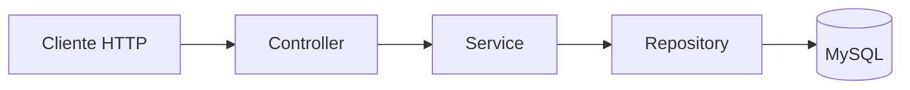

# Stack e Arquitetura de Software

## Tecnologias
- Java 25 e Spring Boot 4.2, rodando em container Docker (Java não está instalado no computador).
- MySQL em container separado.
- Já no `pom.xml`: Spring Web, Validation e MySQL Driver.
- Previstas pelas specs (ainda a confirmar com o `pom.xml` real, ver `CLAUDE.md`): persistência JPA, Spring Security, biblioteca JWT e starter de testes.
- Não adicionar nenhuma dependência sem explicar o motivo e esperar o "ok".

## Pacote base
Usar o pacote base que já existe em `src/main/java/`. Não criar outro e não renomear.

## Organização por domínio (Package by Feature)
Dentro do pacote base:
- `auth/`: login, registro, filtro JWT, geração e validação do token.
- `user/`: entidade `User` e `UserRepository`.
- `url/`: `ShortUrl`, controller, service, repository, DTOs e gerador de código.
- `shared/config/`: beans de configuração (ex: `Clock`).
- `shared/exception/`: exceções de negócio e `@RestControllerAdvice`.

Criar uma pasta só quando uma spec precisar dela.

## Camadas e fluxo

- **Controller:** recebe HTTP, valida a entrada (`@Valid`) e chama o Service. Sem regra de negócio e sem acesso ao Repository.
- **Service:** toda a regra de negócio e as transações.
- **Repository:** só leitura e escrita no banco.
- Dependência sempre de cima para baixo. Nunca o contrário.

## Injeção de Dependência (DI)
Uma classe **recebe** o que precisa, não cria. Nada de `new` para Service, Repository ou componente do Spring.

Regras obrigatórias:
1. Injeção **só por construtor**.
2. Atributos injetados são `private final`.
3. **Proibido** `@Autowired` em atributo e injeção por setter.
4. Um construtor só. Não precisa de `@Autowired` nele.
5. Se o construtor passar de 4 ou 5 parâmetros, a classe está fazendo coisa demais: dividir (ver SRP).
6. Configuração (prazo do link, limite por usuário) vem de propriedades (`@Value` ou `@ConfigurationProperties`), nunca fixa no código.

Exemplo do padrão esperado:
```java
@Service
public class ShortUrlService {

  private final ShortUrlRepository repository;
  private final ShortCodeGenerator codeGenerator;
  private final Clock clock;

  public ShortUrlService(
      ShortUrlRepository repository, ShortCodeGenerator codeGenerator, Clock clock) {
    this.repository = repository;
    this.codeGenerator = codeGenerator;
    this.clock = clock;
  }
}
```

### Hora injetada (`Clock`)
- Proibido `LocalDateTime.now()` e `Instant.now()` sem argumento dentro de Service.
- Registrar um bean `Clock` em UTC em `shared/config/` e injetá-lo.
- Motivo: o link expira em 5 minutos. Com `Clock` injetado, o teste simula a passagem do tempo sem esperar.

## SOLID aplicado a este projeto

| Princípio | Regra neste projeto | Exemplo |
|---|---|---|
| **S**: Responsabilidade Única | Cada classe tem um motivo para mudar | `ShortUrlService` cuida da regra dos links. Gerar código aleatório fica em `ShortCodeGenerator`. Gerar token fica em uma classe de JWT em `auth/`. |
| **O**: Aberto/Fechado | Estender sem editar a classe pronta | Trocar o jeito de gerar o código = nova implementação de `ShortCodeGenerator`, sem mexer no Service. |
| **L**: Substituição de Liskov | Qualquer implementação de uma interface funciona no lugar de outra | Um gerador fixo usado nos testes se comporta como o aleatório de produção. |
| **I**: Segregação de Interface | Interfaces pequenas e específicas | `ShortCodeGenerator` tem 1 método. Não criar interface "faz tudo". |
| **D**: Inversão de Dependência | Service depende de abstração para o que pode variar | Service recebe `ShortCodeGenerator` e `Clock`, não uma classe concreta criada com `new`. |

## Quando criar interface (e quando não)
- **Criar** apenas quando há motivo real: algo que varia ou precisa ser trocado nos testes.
  - `ShortCodeGenerator` (gerar código curto).
  - `Clock` (já é abstração do Java).
- **Não criar** interface para cada Service (`UserService` + `UserServiceImpl`). É excesso de abstração e atrapalha o aprendizado.
- Regra prática: sem segunda implementação nem necessidade de teste, não crie interface.

## Regras de código
- DTOs são `record` (detalhes em `docs/02-api-e-erros.md`).
- Entidade `@Entity` nunca sai do Service para o Controller.
- Exceções de negócio são classes próprias em `shared/exception/`, tratadas num só lugar.
- Métodos curtos, com um propósito. Nomes que explicam o que fazem.
- Sem código comentado, sem classe utilitária "genérica" e sem funcionalidade antecipada.

## Checklist antes de cada commit
- [ ] Nenhum `@Autowired` em atributo.
- [ ] Nenhum `new` de Service, Repository ou componente Spring.
- [ ] Nenhum `now()` sem `Clock` em Service.
- [ ] Controller não acessa Repository.
- [ ] Nenhuma `@Entity` retornada em endpoint.
- [ ] Nenhuma dependência nova sem aprovação.