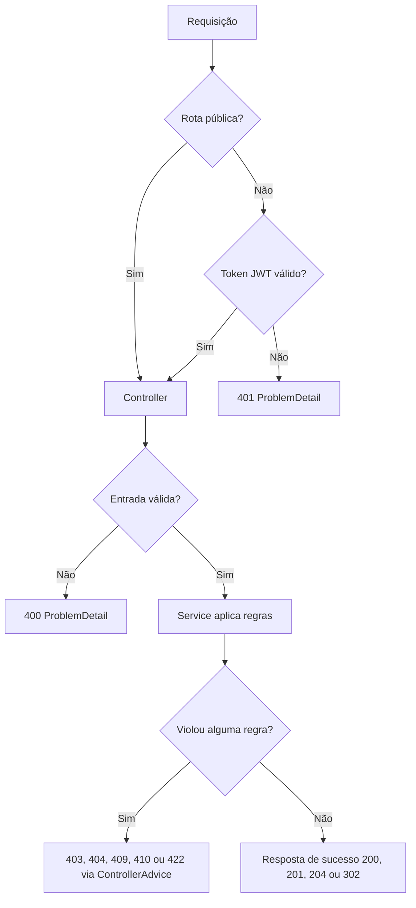

# Contrato HTTP, Segurança e Tratamento de Erros

## URLs e versão
- Todas as rotas da API começam com `/api/v1/` e usam substantivos no plural (`/api/v1/urls`).
- A exceção é o redirecionamento público: `GET /r/{shortCode}`.
- Dados trafegam em JSON.

## DTOs (entrada e saída)
- **Proibido** receber ou devolver entidades `@Entity` nos Controllers.
- Todo DTO é um `record` do Java.
- Nomes: `XxxRequest` para entrada e `XxxResponse` para saída (ex: `CreateShortUrlRequest`, `ShortUrlResponse`).
- Entrada validada com Jakarta Validation (`@NotBlank`, `@Size`, `@Email`) e `@Valid` no Controller.
- A senha **nunca** aparece em nenhuma resposta.

## Rotas públicas e protegidas

| Rota | Acesso |
|---|---|
| `POST /api/v1/auth/register` | Público |
| `POST /api/v1/auth/login` | Público |
| `GET /r/{shortCode}` | Público |
| Qualquer outra (`/api/v1/urls/**`) | Exige `Authorization: Bearer <token>` |

- Qualquer rota nova nasce **protegida**. Só entra na lista pública se uma spec disser.

## Códigos de status usados

| Código | Quando usar |
|---|---|
| 200 OK | Leitura ou login com sucesso |
| 201 Created | Recurso criado (registro, link curto) |
| 204 No Content | Exclusão com sucesso (sem corpo) |
| 302 Found | Redirecionamento do link curto |
| 400 Bad Request | Entrada inválida (campo faltando, formato errado, URL sem http/https) |
| 401 Unauthorized | Sem token, token inválido ou credenciais erradas no login |
| 403 Forbidden | Usuário autenticado tentando mexer em link de outro usuário |
| 404 Not Found | `shortCode` inexistente |
| 409 Conflict | E-mail já cadastrado ou alias já existente |
| 410 Gone | Link existia, mas expirou |
| 422 Unprocessable Entity | Regra de negócio violada (limite de 5 links ativos) |
| 500 Internal Server Error | Falha inesperada. Nunca expor detalhes internos |

## Formato único de erro
- Toda resposta de erro usa `ProblemDetail` (RFC 9457) e `Content-Type: application/problem+json`.
- Campos: `type`, `title`, `status`, `detail`, `instance`.
- O campo `detail` é escrito em português e explica o problema ao usuário da API.
- **Nunca** devolver stack trace, nome de classe, SQL ou texto de exceção interna.
- Existe **um único** `@RestControllerAdvice`, em `shared/exception/`.

Mapeamento de exceções (nomes sugeridos, a spec decide):

| Situação | Status |
|---|---|
| `MethodArgumentNotValidException` | 400 |
| Exceção de negócio "recurso não encontrado" | 404 |
| Exceção de negócio "conflito" | 409 |
| Exceção de negócio "acesso negado ao recurso" | 403 |
| Exceção de negócio "link expirado" | 410 |
| Exceção de negócio "limite atingido" | 422 |
| Qualquer outra exceção não prevista | 500 (mensagem genérica) |

### Atenção: 401 e 403 do Spring Security
Erros de autenticação acontecem **antes** de chegar ao Controller, então o `@RestControllerAdvice` não os captura. O Spring Security precisa de um tratamento próprio (`AuthenticationEntryPoint` para 401) que devolva o **mesmo formato** `ProblemDetail`. Isso é feito na Spec 001. Se houver dúvida sobre como configurar, o Claude Code deve parar e perguntar.

### Segurança nas mensagens
- Login com credenciais erradas: sempre a mesma mensagem genérica, sem dizer se o e-mail existe.

## Exemplos de resposta de erro

**400 Bad Request** (validação, com lista de campos)
```json
{
  "type": "about:blank",
  "title": "Bad Request",
  "status": 400,
  "detail": "Dados inválidos na requisição.",
  "instance": "/api/v1/auth/register",
  "errors": [
    { "field": "email", "message": "deve ser um e-mail válido" }
  ]
}
```

**401 Unauthorized**
```json
{
  "type": "about:blank",
  "title": "Unauthorized",
  "status": 401,
  "detail": "Credenciais inválidas ou token ausente.",
  "instance": "/api/v1/urls"
}
```

**403 Forbidden**
```json
{
  "type": "about:blank",
  "title": "Forbidden",
  "status": 403,
  "detail": "Você não tem permissão para acessar este link.",
  "instance": "/api/v1/urls/aB9x2kL"
}
```

**404 Not Found**
```json
{
  "type": "about:blank",
  "title": "Not Found",
  "status": 404,
  "detail": "Link não encontrado.",
  "instance": "/r/zzzzzzz"
}
```

**409 Conflict**
```json
{
  "type": "about:blank",
  "title": "Conflict",
  "status": 409,
  "detail": "E-mail já cadastrado.",
  "instance": "/api/v1/auth/register"
}
```

**410 Gone**
```json
{
  "type": "about:blank",
  "title": "Gone",
  "status": 410,
  "detail": "Link expirado.",
  "instance": "/r/aB9x2kL"
}
```

**422 Unprocessable Entity**
```json
{
  "type": "about:blank",
  "title": "Unprocessable Entity",
  "status": 422,
  "detail": "Limite de 5 links ativos atingido. Exclua um link ou aguarde um expirar.",
  "instance": "/api/v1/urls"
}
```

## Fluxo geral de uma requisição
