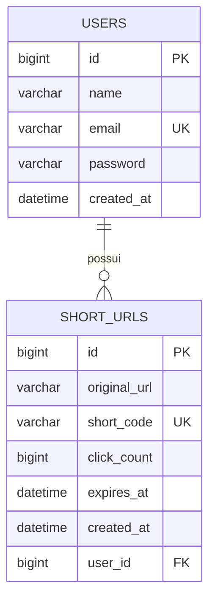

# Banco de Dados MySQL e Persistência

## Configuração geral
- Banco: MySQL em container Docker (versão definida no `docker-compose.yml`, não alterar sem avisar).
- Usuário, senha e nome do banco vêm do `.env`. Nada fixo no código.
- Charset: `utf8mb4`.
- Estratégia de schema nesta fase: `spring.jpa.hibernate.ddl-auto=update`. **Não criar Flyway/migrations agora.**
- Ativar o log de SQL só em desenvolvimento, para aprender como o Hibernate gera as queries.

## Diagrama das tabelas

Um usuário tem vários links. Cada link pertence a um único usuário.

## Convenções
- Nomes de tabelas no **plural**, colunas em **snake_case**, tudo em inglês (`users`, `short_urls`, `short_code`).
- Chave primária: `Long id` com `@GeneratedValue(strategy = GenerationType.IDENTITY)`.
- Relacionamentos `@ManyToOne` com `fetch = FetchType.LAZY`. Nunca `EAGER`.
- Campos obrigatórios com `nullable = false`.
- Entidades **não** têm lógica de negócio. A regra fica no Service.

## Tabela `users`

| Coluna | Tipo | Regra |
|---|---|---|
| `id` | BIGINT | PK, auto incremento |
| `name` | VARCHAR | Obrigatório |
| `email` | VARCHAR(255) | Obrigatório, **único** |
| `password` | VARCHAR | Obrigatório, guarda só o hash BCrypt |
| `created_at` | DATETIME | Preenchido na criação, em UTC |

## Tabela `short_urls`

| Coluna | Tipo | Regra |
|---|---|---|
| `id` | BIGINT | PK, auto incremento |
| `original_url` | VARCHAR(2048) | Obrigatório |
| `short_code` | VARCHAR(20) | Obrigatório, **único**, com índice |
| `click_count` | BIGINT | Obrigatório, padrão 0 |
| `expires_at` | DATETIME | **Obrigatório** (o servidor calcula: criação + prazo configurado) |
| `created_at` | DATETIME | Preenchido na criação, em UTC |
| `user_id` | BIGINT | FK para `users`, obrigatório |

- Índice único em `short_code` (`@Index(name = "idx_short_code", columnList = "short_code", unique = true)`): o redirecionamento busca por ele a cada acesso.
- O índice único de `email` vem de `@Column(unique = true)`.
- O MySQL (InnoDB) cria automaticamente índice na FK `user_id`.

## Datas e fuso horário
- Todos os timestamps são `LocalDateTime` **em UTC**.
- Quem fornece a hora é o bean `Clock` injetado (ver `docs/01-stack-e-arquitetura.md`). Proibido `now()` sem `Clock` em Service.
- O banco não preenche datas sozinho. Quem preenche é o Service, com o `Clock`.
- **Atenção:** guias antigos configuravam `serverTimezone=America/Sao_Paulo` na URL JDBC e `TZ` no MySQL. Isso pode misturar UTC com horário local e adiantar ou atrasar a expiração. O Claude Code deve **ler** a configuração atual, apontar o conflito e **perguntar antes de alterar**. A direção recomendada é gravar e ler tudo em UTC.

## Prazo e limite por usuário
- Prazo do link: 5 minutos (300 segundos), configurável em `app.links.ttl-seconds`.
- Limite: 5 links **ativos** por usuário, configurável em `app.links.max-per-user`.
- Link **ativo** = `expires_at` depois de agora (hora vinda do `Clock`).
- Links expirados **não contam** no limite e continuam no banco até o usuário excluí-los.
- Contar com query no Repository (um `count`), nunca carregando a lista inteira na memória.

## Consultas
- Padrão: métodos derivados do Spring Data (`findByShortCode`, `existsByEmail`).
- JPQL só se o método derivado ficar ilegível.
- SQL nativo (`nativeQuery = true`): **não usar neste projeto**.
- Nunca montar SQL concatenando texto vindo do usuário.
- Evitar o problema N+1: não acessar relacionamento `LAZY` dentro de loop.

## Transações
- `@Transactional` no Service, nunca no Controller.
- Contagem de cliques: incremento e `save` na mesma transação (Spec 003).

## Limitações conhecidas (aceitas, é projeto de estudo)
- Duas requisições simultâneas podem ultrapassar o limite de 5 links, porque a contagem e a gravação não são atômicas.
- Dois acessos simultâneos ao mesmo link podem perder um incremento do `click_count`.
- Resolver isso exigiria lock ou query atômica, fora do escopo desta fase.

## Migrations (futuro)
`ddl-auto=update` é só para esta fase de aprendizado: ele nunca apaga colunas antigas e não renomeia campos com segurança. Num projeto real, trocar por Flyway com `ddl-auto=validate`. Não fazer isso agora.